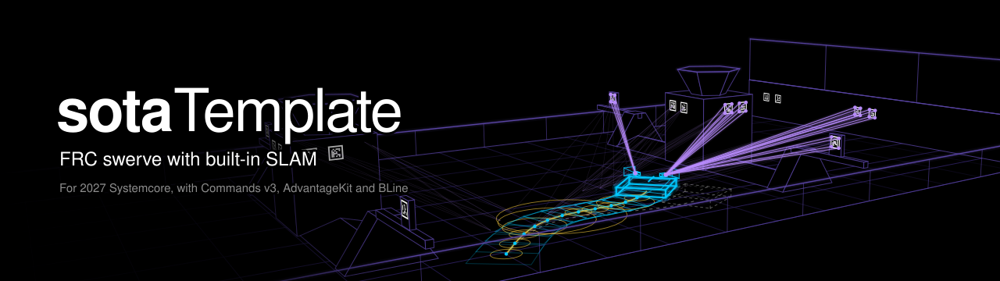
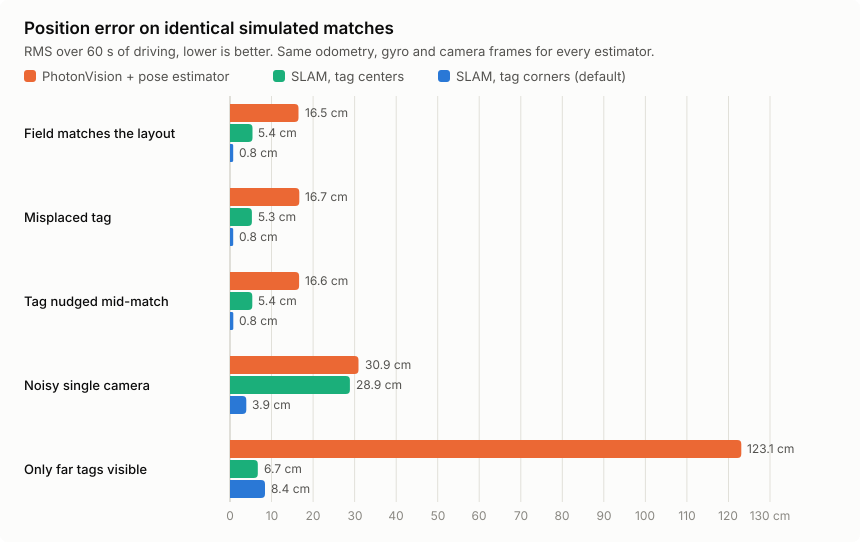
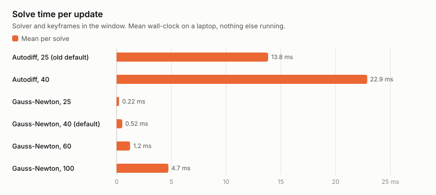
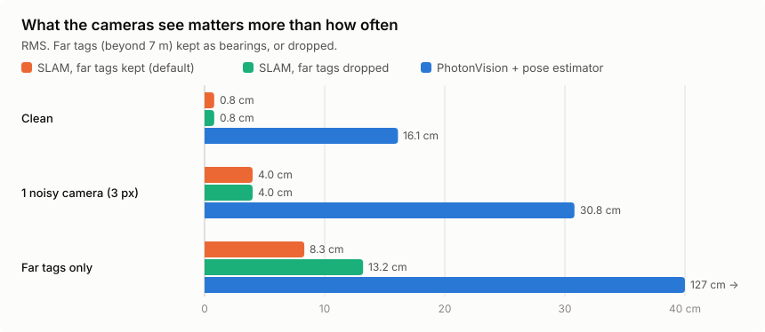
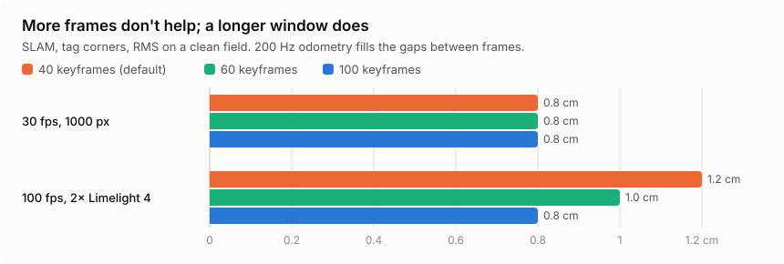

A opinionated 2027 (Systemcore) FIRST Robotics Competition template

> [!IMPORTANT]
> This is in beta, and has never been tested on a real robot

It is based on the AdvantageKit [TalonFX swerve](https://docs.advantagekit.org/getting-started/template-projects/talonfx-swerve-template/) and [vision](https://docs.advantagekit.org/getting-started/template-projects/vision-template) templates. Two things replace their pose estimation and pathing:

- **SLAM localization.** A sliding-window factor graph over gyro, 200 Hz wheel odometry and the raw corners of every AprilTag, solved every loop in about half a millisecond. It replaces `SwerveDrivePoseEstimator`, MegaTag and PhotonVision's multi-tag estimator.
- **[BLine](https://docs.bline.run) for every automatic drive.** Autos and teleop auto-drive share one follower, one set of gains and one set of constraints. Paths are drawn in the [BLine editor](https://bline.run) or written in code, and followed by progress, not time, so the robot can never fall behind its path. There is no PathPlanner.

**In our [benchmark](docs/benchmarks/RESULTS.md) the SLAM is about 1 cm RMS, where the usual PhotonVision + pose estimator pipeline is about 16 cm** on the same simulated matches.

It also comes with batteries included, all working in simulation and on the robot:

- **A map that remembers.** The SLAM learns where every tag *really* is and saves the map to the robot's disk on every disable. If a tag gets knocked in quals 3, the robot already knows in quals 4, even after a reboot. A tag that is nudged mid-match is detected and re-learned within seconds. See [The map](#the-map-learned-tags-that-survive-reboots).
- **Tag corners, not just centers.** Every tag contributes four corner reprojections through each camera's full 3D mount. That's far more accurate at range, measures each tag's yaw too, and only needs a cheap 2D pipeline. See [Vision](#vision).
- **Detection QC.** Every detection from every backend passes the same checks before it reaches the SLAM: unknown or duplicate IDs, ambiguity, non-convex or tiny or wildly oblique corners, and ranges that disagree with the tag's apparent size. Every rejection is counted and logged.
- **Slip and collision detection.** Every loop the wheels are checked against each other, the gyro and the accelerometer. While they slip (pinned, spun out, hit), the SLAM discounts their travel and leans on vision. Pinned for 1.5 s with the wheels spinning, the pose is back within 4 cm a second after release. See [Slip and collisions](#slip-and-collisions).
- **Localization confidence.** A pose uncertainty (meters and degrees) and a 0–1 confidence are published every loop. Teleop auto-drive waits for confidence before it moves. See [Confidence](#confidence).
- **Teleop auto-drive and acceleration limits.** Hold a button to drive to a pose, or through waypoints, with the auto follower and optional constraints. The joystick drive is acceleration-limited so the wheels keep their grip. See [Teleop](#teleop-auto-drive-and-acceleration-limits).
- **OpModes.** A `Driver` teleop; `Path Two Piece`, `Two Piece`, `Waypoint Demo` and `Do Nothing` autos; and `Drive FF Characterization` and `Wheel Radius Characterization` utilities. They are discovered automatically and picked from the driver station. See [Commands v3 and OpModes](#commands-v3-and-opmodes).
- **State machine.** A superstructure skeleton on the Commands v3 `StateMachine` (IDLE → INTAKING → HOLDING → SCORING), wired to the driver's bumper and trigger. Copy it for your mechanisms. See [State machines](#state-machines).
- **A complete example mechanism.** An `Intake` on a TalonFX roller and a CANrange piece sensor, with full configs and current limits. In sim the same Talon code runs against CTRE's device simulation.
- **Auto builder.** `Auto.create(...).startAt(A).followPath("score-preload").then(intake::eject).driveTo(B)`, written once in blue coordinates and flipped for red automatically. See [Autos](#autos-auto-builder-paths-and-fieldposes).
- **Named field poses.** `FieldPoses` holds start, pickup and scoring spots, logged as ghost robots in AdvantageScope.
- **Vision backends.** Limelight (LimelightLib) and PhotonVision (photonlib), chosen per camera and mixable, plus a simulated camera. Both feed raw corners.
- **Live tuning.** Auto-drive, teleop, traction, SLAM and intake parameters can be edited from the dashboard, and replay stays exact. See [Live tuning](#live-tuning).
- **Drivable sim.** `./gradlew run -PsimGui` with a keyboard (WASD + QE) or any gamepad. Simulated sensors have realistic errors, so you can watch the SLAM correct them. See [Driving the simulator](#driving-the-simulator).
- **Robot tests and benchmarks.** JUnit tests boot the real robot, select OpModes, press buttons, pin the robot mid-path and check where it drives. Further tests check SLAM accuracy, map persistence, every camera backend and QC. `./gradlew benchmark` compares the SLAM with PhotonVision. See [Tests](#tests).

The code is Java and uses **Commands v3** (coroutine commands and `Mechanism`s) and **OpModes** (`@Teleop`, `@Autonomous`, `@Utility`). AdvantageKit logging and replay are kept intact.

## Versions

| | Version |
|---|---|
| WPILib / GradleRIO | `2027.0.0-alpha-7` |
| AdvantageKit | `27.0.0-alpha-7` |
| Phoenix 6 | `26.70.0-alpha-2` |
| LimelightLib | `2.0.0-beta9-alpha7` |
| PhotonLib | `dev-v2027.0.0-alpha-2-90` (a PhotonVision dev build that targets `2027_alpha7`) |
| BLine-Lib | `v2027.0.0-beta.3` (the 2027 beta, which targets `2027_alpha7`) |
| Commands v3 | bundled with WPILib |
| Java | 25 |
| Systemcore image | alpha/beta 14+ |

The versions are pinned to alpha-7 because that is the newest WPILib that AdvantageKit and CTRE both support. When the 2027 kickoff release ships, bump `build.gradle` and `vendordeps/`.

## Commands

```bash
./gradlew build    # compile, format (spotless), and run tests
./gradlew run -PsimGui  # simulate with the sim GUI: drive with a keyboard or gamepad
./gradlew run      # headless sim: boots the robot with no GUI or DS, which is useful for smoke and replay checks
./gradlew benchmark     # PhotonVision vs the SLAM on identical simulated matches -> docs/benchmarks/RESULTS.md
./gradlew deploy   # deploy to the Systemcore (team number in .wpilib/wpilib_preferences.json)
./gradlew replayWatch
```

### Driving the simulator

Run `./gradlew run -PsimGui`. In VS Code, **WPILib: Simulate Robot Code** with **Sim GUI** ticked does the same thing. Pick an OpMode in the GUI's driver station panel and enable it.

`simgui-ds.json` (committed) maps **Keyboard 0** to joystick 0 as a gamepad:

| Keys | Control |
|---|---|
| W / S | left stick Y (drive forward/back) |
| A / D | left stick X (strafe) |
| Q / E | right stick X (turn) |
| Z / X / C / V | A / B / X / Y buttons |

Any real USB or Bluetooth gamepad also works with no setup; the 2027 sim GUI uses SDL. Drag it onto slot 0 in the GUI.

Watch it in AdvantageScope by connecting to `localhost`. Useful fields: `SimWorld/TruePose` (ground truth), `Localization/EstimatedPose`, `Localization/Keyframes`, `Localization/TagMap` against `Localization/TagLayout`, `FollowPath/pathTranslations`, and `FieldPoses/All`.

You need JDK 25, which the 2027 WPILib installer provides. If your `~/.gradle/gradle.properties` pins an older JDK with `org.gradle.java.home`, override it with `-Dorg.gradle.java.home=<jdk25>`.

## Layout

| Path | Contents |
|---|---|
| `first/robot/Robot.java` | `LoggedOpModeRobot`. Builds everything and runs the loop: sensors → localization → scheduler. Saves the tag map on disable. |
| `first/robot/opmodes/` | `teleop/DriverTeleop`, `auto/{PathFileAuto,TwoPieceAuto,WaypointAuto,DoNothingAuto}`, and the characterization OpModes in `utility/`. These are discovered automatically. |
| `first/robot/FieldPoses.java` | Named field poses (starts, pickups, scoring) in blue coordinates, logged as alliance-flipped ghosts. |
| `first/robot/autos/` | `Auto` (fluent builder over coroutines). |
| `src/main/deploy/autos/` | The BLine project: `config.json` (default constraints) and `paths/*.json`. Open it in the [BLine editor](https://bline.run). |
| `first/robot/subsystems/intake/` | Example mechanism: `Intake`, `IntakeIO`, `IntakeIOTalonFX` (TalonFX + CANrange, full config) and `IntakeIOTalonFXSim` (the same Talon code on CTRE's simulator). |
| `first/robot/superstructure/Superstructure.java` | Skeleton Commands v3 `StateMachine`: IDLE → INTAKING → HOLDING → SCORING. |
| `first/robot/subsystems/drive/` | `Drive` (a v3 `Mechanism`, 200 Hz odometry), `TractionMonitor` (slip and collision detection), `Module`, and the IO layers `ModuleIO{TalonFX,Sim}` and `GyroIO{Pigeon2,Sim}`. |
| `first/robot/subsystems/vision/` | `Vision`, `TagQC`, `VisionIOLimelight`, `VisionIOPhotonVision`, `VisionIOSim`, and camera calibration and per-camera backend in `VisionConstants`. |
| `first/robot/localization/` | `SlamEstimator` (the solver), `SlamConfig` (all tuning), `Localization` (the robot wrapper and logging), and `TagMapIO`/`TagMapIOFile` (map persistence). |
| `first/robot/commands/` | `AutoDrive` (BLine: paths and drive-to-pose, for autos and teleop) and `DriveCommands` (acceleration-limited joystick drive, feedforward and wheel-radius characterization). |
| `first/robot/util/` | `TunableNumber` (replay-safe live tuning), `AllianceFlip`, `CameraUndistort`, `PhoenixUtil`. |
| `first/robot/sim/SimWorld.java` | Ground truth for simulation, with deliberately imperfect sensors. |
| `first/robot/generated/TunerConstants.java` | Phoenix Tuner X output. Replace it with your robot's. |

## Simultaneous Localization and Mapping algorithm

Every keyframe (one per camera frame, plus odometry-only ones every 0.5 m, 25° or 0.5 s) gets a pose `(x, y, θ)`. Every tag in the window gets `(x, y, yaw)`, with height and tilt from the layout. One scalar each is solved for the gyro offset and the wheel odometry scale. The solver minimizes:

| Factor | Residual | Why |
|---|---|---|
| Gyro | `θₖ − (gyroₖ + offset)` | The gyro owns heading; the offset is solved, so it never needs zeroing. |
| Odometry | wheel translation between keyframes, in the earlier keyframe's frame, times `scale` | `scale` calibrates tread wear online. Travel while slipping is discounted. See [Slip and collisions](#slip-and-collisions). |
| Tag corners | each corner, placed from the tag pose through the robot pose and the camera's 3D mount, against where the camera saw it | The default. Pins position, heading and the tag's own yaw. |
| Tag center | bearing, and range up to `rangeTrustMeters` (7 m) | Without corners, and for every tag beyond 7 m, where range from apparent size is unreliable. |
| Window prior | the oldest keyframe's pose | Summarizes what slid out of the window. |
| Tag prior | the surveyed layout plus what past sightings learned | The mapping half. See [The map](#the-map-learned-tags-that-survive-reboots). |

- **Robust.** Vision factors use a pseudo-Huber kernel; gross outliers are gated out first.
- **Multi-tag, stereo and multi-frame for free.** Each sighting is one factor on shared variables, so a single frame never has to produce a pose and planar ambiguity can't flip it.
- **Fast.** The default solver (`SlamConfig.solver = GAUSS_NEWTON`) uses hand-derived Jacobians and a damped Gauss-Newton step: about 0.5 ms at 40 keyframes on a laptop. It runs inside the loop, so the pose is never stale. `AUTODIFF` (WPILib's Sleipnir) minimizes the same cost and agrees to nanometers, but is about 40× slower and needs `solveLatencyLoops = 3` on a second core.
- **Deterministic.** Iteration-bounded, never reads a clock, and uses `StrictMath`, so log replay reproduces every pose.

On the robot, check `Localization/Solve/{BuildMs,SolveMs}`. Too slow: lower `maxKeyframes` or set `solveLatencyLoops`.

### Results

[`docs/benchmarks/RESULTS.md`](docs/benchmarks/RESULTS.md) (`./gradlew benchmark`): identical simulated matches for every estimator, mean of 5 seeds.

<picture>
  <source media="(prefers-color-scheme: dark)" srcset="docs/benchmarks/position-error-dark.svg">
  
</picture>

<picture>
  <source media="(prefers-color-scheme: dark)" srcset="docs/benchmarks/solve-time-dark.svg">
  
</picture>

### Tuning

Everything is in `SlamConfig`, live-tunable under `/Tuning/Slam`. Set the camera noise in `VisionConstants.CAMERAS` first, then:

- `Localization/VisionLagSecs` should be a few tens of ms. Anything else means camera and odometry clocks disagree, and every sighting is silently rejected.
- `Localization/QC/GateRejections` climbing: camera timestamps or `robotToCamera` are wrong.
- `Localization/QC/TagResidualSigma` should be about 1 for every tag. One high tag is moved or misdetected; all high means calibration or mount.
- `Localization/OdometryScale` far from 1.0: run the wheel radius characterization.
- `maxKeyframes` sets the window's length in time. See [Cameras](#cameras-detection-over-frame-rate).

### Before the robot is localized

Until a tag is seen, heading is assumed to face away from your driver station (offset 0 on blue, π on red); the solver corrects it after. Autos call `resetPose` only if vision hasn't localized yet. B resets heading manually.

### Slip and collisions

`TractionMonitor` flags slip every loop when any of these fires:

- **Scrub:** the four modules disagree with the best rigid-body fit (a wheel sliding or spinning).
- **Yaw rate:** wheels and gyro disagree on turn rate.
- **Accelerometer:** wheel velocity disagrees with the IMU's. An event (accelerations disagree, or a check above fires) is latched, and the IMU velocity stops following the wheels until the two agree again, the wheels stop, or `Traction/MaxLatchSecs` (5 s) passes. A pin stays flagged the whole time, and honest wheels aren't flagged after release.

A collision (acceleration above `Traction/CollisionThresholdG`) is logged separately, not as slip.

The SLAM gets the slip flag with every odometry sample. It keyframes where slip starts and stops, believes only `slipOdometryTrust` (25%) of the travel between, with σ `slipStdDevPerMeter` (1 m/m), and widens the outlier gate to match. On a 3 s pin that cuts the worst error from 29 cm to 11 cm. See `Drive/Traction/*`, `Drive.isSlipping()` and `Drive.hadCollision()`.

### Confidence

Under `Localization/Confidence/*`:

- `PositionStdDevMeters`, `HeadingStdDevDeg`: approximate 1σ from the window's tag fixes plus odometry noise since the newest (slip included). About 1 cm watching tags, 17 cm after 4 m blind, meters while slipping.
- `Value`: probability the pose is within 5 cm and 3° (`Confidence*ToleranceMeters/Deg`).
- `Confident`: `Value` ≥ 0.9. Gate aligning and auto-scoring on `localization.isConfident()`; teleop auto-drive already does.

## The map: learned tags that survive reboots

Real fields are never exactly the layout, and tags get bumped:

- **It learns.** Tag poses are solved with the path. Evidence leaving the window folds into a learned prior on top of the surveyed layout, which is never removed, so the map can't drift off the field.
- **It forgets slowly**, over about 200 sightings (`mapMemoryObservations`).
- **It notices moved tags.** A tag that clearly moved is forgotten, released from the layout and re-placed within a second or two (`Localization/QC/MovedTagEvents`).
- **It survives reboots.** Saved on every disable to `<robot home>/sota/tagmap.csv` (atomic, brownout-safe) and loaded through logged inputs, so replay starts from the same map. A map for another field layout is ignored.

Tested: a tag 15 cm off is learned to under 1 cm, starts at 1.5 cm after a reboot, and a tag knocked 20 cm mid-match is re-learned to under 1 cm. Reset at a new venue with `/Localization/ResetTagMap`; disable with `Constants.persistTagMap` or `SlamConfig.mapTags`.

## Vision

### What to run on the camera

The SLAM needs only each tag's four corners and the camera's calibration. **A calibrated 2D AprilTag pipeline is enough.** Skipping the camera's per-tag PnP buys frame rate and latency, and the camera's own pose estimators go unused:

| | Do | Don't need |
|---|---|---|
| **Limelight** | AprilTag pipeline with **Send Corners** on, and an uploaded custom calibration (the factory one works, but raises an alert) | MegaTag 1/2, robot orientation updates |
| **PhotonVision** | AprilTag pipeline in **2D**, camera **calibrated at the pipeline's resolution** (the 2D/3D toggle stays greyed out until it is) | 3D mode, multi-tag on coprocessor, `PhotonPoseEstimator` |

Without corners (no calibration, or Send Corners off), a camera falls back to tag centers. That still works, but is less accurate (see the benchmark).

### Cameras: detection over frame rate

<picture>
  <source media="(prefers-color-scheme: dark)" srcset="docs/benchmarks/detection-dark.svg">
  
</picture>

<picture>
  <source media="(prefers-color-scheme: dark)" srcset="docs/benchmarks/frame-rate-dark.svg">
  
</picture>

- **Spend on detection, not frames.** 200 Hz odometry carries the pose between frames, so 30–50 fps is plenty. What moves accuracy is which tags are seen and how cleanly: resolution, calibration, short exposure (≤ 0.5 ms keeps motion blur under a pixel) and a detector that finds small tags.
- **Detectors differ a lot on small tags.** In [one forum test](https://www.chiefdelphi.com/t/introducing-napa-a-faster-apriltag-detector/525801) on a Raspberry Pi 5 module, NAPA found every tag from 22 px; AprilTag at WPILib defaults only from 80 px. Measure your own camera at known distances.
- **Size the window in time.** It spans about `maxKeyframes` ÷ keyframes per second, and every camera frame is a keyframe (two cameras share one only within 8 ms). Two unsynchronized 50 fps cameras make up to 100 keyframes/s, so the default 40 is 0.4 s. Raise `maxKeyframes` with the frame rate: 60 costs about 1.2 ms, 100 about 4.7 ms.

### Configuration alerts

A misconfigured camera degrades the SLAM quietly, so `Vision` raises a WPILib alert (group `Vision`, key `<camera><Problem>`) and a driver station warning once a problem holds for about 1 s on a connected camera. Replay raises the same alerts.

| Alert | Level | Raised when | Backends |
|---|---|---|---|
| `Uncalibrated` | high | no calibration is published, so only tag centers are usable | both |
| `NoCorners` | high | tags arrive but none have corners (Send Corners off). Holds while no tags are in view | any |
| `FactoryCalibration` | medium | the Limelight has no uploaded custom calibration | Limelight |
| `UnsupportedDistortion` | medium | the calibration has nonzero terms beyond k1, k2, p1, p2, k3, which `CameraUndistort` ignores | Limelight |
| `PoseEstimation` | low | the pipeline runs PnP (3D mode), which the SLAM doesn't use and only adds latency | PhotonVision |

### How corners are handled

- **Undistortion.** PhotonVision reports corners exactly as its detector found them, in distorted pixels; it only applies its calibration inside its own PnP and to the target center. Limelight is the same. Both IO layers undistort the corners with the camera's own published calibration (`CameraUndistort`, pure Java) and normalize them by focal length.
- **Order.** QC puts every tag's corners into one canonical order by geometry (bottom-left, bottom-right, top-right, top-left as seen facing the tag), so a backend's own corner order can't scramble the reprojection.
- **Center.** The tag center is recomputed from the corners as the intersection of the diagonals, which is exact under perspective. Vendor yaw/pitch conventions then don't matter: PhotonVision's pipeline and its own simulator compute pitch differently.
- **Range.** Range comes from the tag's vertical edges, which don't foreshorten when an upright tag is seen from the side. A PnP distance, if the camera sends one, is checked against it.

### QC

`TagQC` runs on every detection from every backend. Each reason is logged per camera as a running count under `Vision/<camera>/QC/`, alongside detections, accepted and accepted-with-corners counts.

| Check | Action |
|---|---|
| ID not in the layout, duplicate ID in one frame, ambiguity above `MAX_AMBIGUITY`, non-finite center | drop the detection |
| Corners not convex, smaller than about 12 px, or opposite edges differing by more than 3× | drop the corners, keep the center |
| Reported range more than 50% off the apparent-size range | drop the range |

The SLAM adds its own QC on top: the outlier gate (`Localization/QC/GateRejections`), per-tag residual and map disagreement (`Localization/QC/TagResidualSigma`, `.../TagMapDisagreementSigma`), released tags and moved-tag events.

## Driving itself: BLine and `AutoDrive`

Every automatic drive goes through `AutoDrive`, built on [BLine](https://docs.bline.run): one follower, one set of PID gains (`AutoDrive/*Kp`) and one set of default constraints, for autos and teleop alike. BLine follows polylines by progress, not time. It projects the robot onto the path, so a robot that is bumped or pinned carries on from where it actually is instead of cutting corners to catch up with a setpoint.

```java
autoDrive.follow("score-preload");                          // drawn in the BLine editor
autoDrive.follow(new Path(new Path.Waypoint(FieldPoses.SCORE_LEFT)));  // or written in code
autoDrive.driveTo(FieldPoses.SCORE_CENTER);                 // drive to a pose and stop
autoDrive.driveTo(FieldPoses.SCORE_CENTER,
    new Path.PathConstraints().setMaxVelocityMetersPerSec(2.0));       // with constraints
autoDrive.driveThrough(List.of(a, b, c), constraints);      // flow through a and b, stop at c
autoDrive.driveToFieldPose(() -> target, constraints);      // a pose already in field coordinates
```

- Poses and paths are in blue coordinates and flipped for red when the command starts. `AllianceFlip` points BLine at the same field size, so autos, teleop targets and `FieldPoses` always agree.
- Constraints are BLine's `Path.PathConstraints`: velocity, acceleration, angular limits (also over a range of a path's elements) and end tolerances. Anything you leave unset uses the `AutoDrive/*` defaults.
- Path files live in `src/main/deploy/autos/paths/`, with defaults in `autos/config.json`. Open the folder in the [BLine editor](https://bline.run) to draw them. Event triggers in a path run actions registered with `FollowPath.registerEventTrigger(key, …)`. `Path Two Piece` starts the intake this way.
- In autos a path gives up after `AutoDrive/StallTimeoutSecs` without the pose moving, so a pinned robot doesn't hang the routine. Teleop commands never time out: the driver lets go.
- BLine commands speed = `TranslationKp` × distance left, then limits acceleration. **Keep `TranslationKp` × max velocity ≤ max acceleration.** Otherwise, near the end, P asks to slow down faster than the limiter allows and the robot overshoots. The defaults are 2.0 × 3.5 m/s ≤ 8 m/s².
- BLine's telemetry is logged through AdvantageKit under `FollowPath/*`, so it is in replay too.

## Teleop: auto-drive and acceleration limits

In `DriverTeleop`, hold **Y** to drive to `SCORE_CENTER`, or the **left bumper** to drive to `PICKUP_LEFT` through a waypoint, capped at 2 m/s. Both are wrapped in `autoDrive.onceConfident(...)`: the robot holds still until `localization.isConfident()`, because driving itself somewhere on a pose it doesn't trust is how a robot ends up in a wall. Let go to take control back.

Bind your own the same way:

```java
driver.rightStick().whileTrue(autoDrive.onceConfident(autoDrive.driveTo(() -> nearestScoringSpot(), constraints)));
```

Joystick drive is acceleration-limited (`Teleop/MaxAccelerationMetersPerSec2`, `Teleop/MaxAngularAccelerationRadPerSec2`) in the field frame, so spinning while driving doesn't count as acceleration. Slamming the stick no longer breaks traction, which also keeps the odometry honest for the SLAM. It continues from whatever the previous command was asking for, so taking over from an auto-drive doesn't jerk the robot.

## Autos: `Auto` builder, paths and `FieldPoses`

Write poses once, in blue coordinates, in `FieldPoses`. Chain them with the builder; flipping for red happens when the auto runs.

```java
Auto.create("TwoPiece", robot.autoDrive, robot.localization)
    .startAt(FieldPoses.START_CENTER)          // only resets pose if vision hasn't localized yet
    .followPath("score-preload")                // a path from the BLine editor
    .then(intake::eject)                        // run a command to completion
    .alongWith(intake::intakeUntilHeld)         // start in the background, keep going
    .passThrough(FieldPoses.SCORE_LEFT)         // flow through without stopping...
    .driveTo(FieldPoses.PICKUP_LEFT)            // ...and stop here: one BLine path
    .waitUntil(intake::hasPiece)
    .driveTo(FieldPoses.SCORE_CENTER, new Path.PathConstraints().setMaxVelocityMetersPerSec(2.0))
    .then(intake::eject)
    .build();
```

Other steps are `followPath(Path)`, `waitSeconds` and `thenRun`. Consecutive `passThrough` and `driveTo` steps become one path. A `passThrough` followed by any other step stops at its pose. Progress is logged to `Auto/Step`, the route to `Auto/PlannedPath`, and the active path to `FollowPath/*`. Every `FieldPoses` constant is logged each loop as `FieldPoses/<NAME>` and `FieldPoses/All`, already flipped for the current alliance.

## State machines

`Superstructure.stateMachine(...)` is a skeleton built on the Commands v3 `StateMachine`:
- Each state runs one command.
- Transitions are `state.switchTo(other).when(condition)`, or `.whenComplete()` to move on when the state's command finishes.
- The machine itself requires nothing; its state commands require the mechanisms they move, so a higher-priority driver command on a mechanism interrupts it cleanly.

The current state is logged to `Superstructure/State`. Teleop runs it for the whole session: hold the right bumper to intake, pull the right trigger to score.

**Gotcha:** pass state machines raw conditions such as `() -> gamepad.getRightTrigger() > 0.5`. A Commands v3 `Trigger` that isn't bound to a command is never polled, so it always reads `false`.

## Live tuning

With `Constants.tuningMode = true`, every `TunableNumber` is editable from any NetworkTables dashboard under `/Tuning`. The ones included:

| Group | Parameters |
|---|---|
| `AutoDrive/*` | follower gains, default speed, acceleration and tolerances, handoff radius, stall timeout; read when each command starts |
| `Teleop/*` | joystick acceleration limits |
| `Traction/*` | slip and collision thresholds |
| `Localization/*` | what counts as confident |
| `Slam/*` | window size, iterations, odometry/gyro noise, robust kernel, outlier gate; read every solve |
| `Intake/*` | roller voltages |

Values go through AdvantageKit's `LoggedNetworkNumber`, so they are logged as inputs and log replay reproduces a tuning session exactly. WPILib's `Tunables` are not logged by AdvantageKit and would break replay. Set `tuningMode = false` for competition: tunables then return their defaults and publish nothing.

## Tests

`./gradlew build` runs every test. Each test class runs in its own JVM (`forkEvery = 1`).

| Test | What it covers |
|---|---|
| `SlamEstimatorTest` | SLAM accuracy, corners against centers, unknown start, learning a misplaced tag, the map surviving a reboot through the real file IO, re-learning a tag nudged mid-match, a 3 s pin with and without the slip reported, the confidence estimate while seeing tags, driving blind and slipping, and both solvers converging to the same answer |
| `GaussNewtonSolverTest` | The hand-derived Jacobians against finite differences, for every factor type |
| `SimPipelineTest` | The full sim sensor stack into `Localization` |
| `OpModeTest` | Boots the real `Robot`, selects OpModes and presses buttons through `DriverStationSim`. Covers field-relative teleop, no duplicate bindings across disable and enable, the superstructure state machine on the Talon-sim intake, all autos finishing on target, the `Path Two Piece` auto pinned mid-path with its wheels spinning (slip detected, cleared on release, pose recovered, both pieces scored), teleop auto-drive on the Y button, and the teleop acceleration limit. |
| `CameraBackendTest` | Limelight (with real lens distortion and corners in a scrambled order), PhotonVision (its own `VisionSystemSim`, including a tag 35° off-axis) and the template's sim camera, all checked against known geometry: corner order and position, bearing sign, range, and timestamp timebase. A field-wide sweep also checks that the sim camera never reports a tag seen from behind. |
| `TagQCTest` | Each QC rule, and canonical corner ordering, including tags seen nearly edge-on |
| `TractionMonitorTest` | Scripted drives, no HAL: a pin with only the accelerometer to see it (flagged throughout, cleared on release), 0.03 g of accelerometer bias (never flags), a one-sample glitch and a pin past the latch cap (never stuck) |
| `LocalizationBenchmark` | Not part of `build`; run with `./gradlew benchmark` |

`RobotHarness` runs the real `LoggedOpModeRobot` loop on a background thread and advances paused HAL time only while that thread is parked between loops. Every step is therefore exactly one complete loop, and tests never read half-written state. Use it to test your own OpModes.

> 2027 note: `RobotController.getMonotonicTime()` and NetworkTables timestamps are both in **nanoseconds**; earlier years used microseconds. Anything hand-rolled against raw NetworkTables needs to account for this: get it wrong and every camera frame lands at a nonsense time, and nothing else would notice. `CameraBackendTest` checks each backend's timebase, and `Localization/VisionLagSecs` shows it on the robot.

## Commands v3 and OpModes

- Mechanisms have no `periodic()`. `Robot.robotPeriodic()` reads every IO layer, then localizes, then runs `Scheduler`. Keep it that way so commands always see this loop's sensor data.
- Teleop bindings are made inside a session command scheduled in `start()`, not in the constructor. `LoggedOpModeRobot` re-creates the selected OpMode after every disable, under the same OpMode ID, so constructor bindings would pile up. Triggers created inside a command are scoped to that command and disappear when it is cancelled. Robot-wide defaults (such as `drive.idle()`) are set in `Robot`.
- Autos and utilities schedule their routine in `OpMode.start()`.
- Commands are cancelled in `disabledInit()`, because v3 doesn't do this on its own. The tag map is also saved there. Characterization routines print their results when cancelled.

## Hardware setup

1. Generate `TunerConstants` with Tuner X. Keep the `kCANBus` line: `new CANBus(CANPort.CAN_S0)` for a Systemcore bus, or `new CANBus("name")` for a CANivore. Drive odometry is sampled at 200 Hz (`Drive.ODOMETRY_FREQUENCY`).
2. In `VisionConstants`, set each camera's name, backend (`LIMELIGHT` or `PHOTONVISION`), `robotToCamera` transform and noise, then set the cameras up as in [What to run on the camera](#what-to-run-on-the-camera). Limelights plugged into Systemcore over USB are named `limelightsc0..2`.
3. Set the intake's CAN IDs, bus, gear ratio, invert and CANrange threshold in `IntakeConstants`.
4. Set `VisionConstants.FIELD` to the 2027 field once it's published, update `FieldPoses` and the paths in `src/main/deploy/autos/paths` (in the [BLine editor](https://bline.run)), and check whether `AllianceFlip` should rotate or mirror.
5. Set your team number in `.wpilib/wpilib_preferences.json`.
6. Run the `Wheel Radius Characterization` and `Drive FF Characterization` utility OpModes.
7. Set `AutoDrive/MaxAccelerationMetersPerSec2` and `Teleop/MaxAccelerationMetersPerSec2` to what your wheels can actually grip, then tune the `AutoDrive/*Kp` gains, keeping `TranslationKp` × max velocity ≤ max acceleration.
8. Drive into a wall and watch `Drive/Traction/*`: `Slipping` should go true while the wheels spin and false soon after. Nudge the `Traction/*` thresholds if normal driving flags it.
