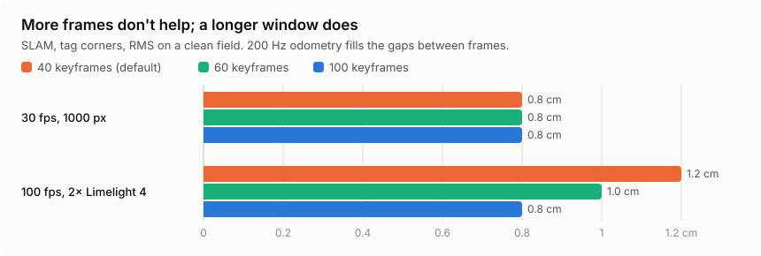
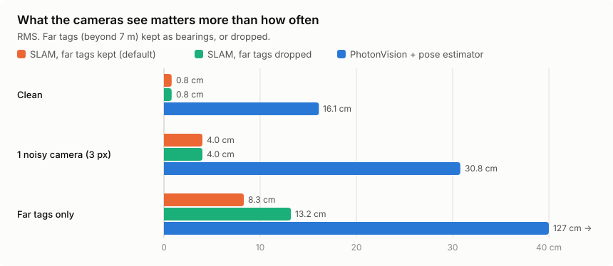
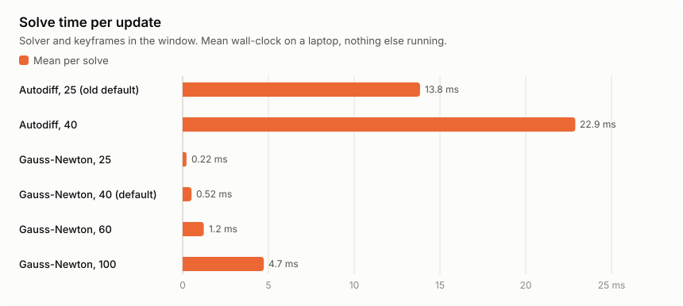

# Localization benchmark

<picture>
  <source media="(prefers-color-scheme: dark)" srcset="position-error-dark.svg">
  
</picture>

`./gradlew benchmark`, 2026-11-26. Same matches for every estimator, mean of 5 seeds. See [Setup](#setup).

## Position error

RMS / p95, cm.

| Estimator | Clean | Misplaced tag | Nudged tag | 1 noisy camera | Far tags only | 2× LL4, 100 fps |
|---|---|---|---|---|---|---|
| PhotonVision + pose estimator | 16.1 / 12.7 | 16.2 / 13.7 | 16.2 / 13.4 | 30.8 / 47.5 | 126.8 / 295.7 | 16.3 / 26.8 |
| SLAM, tag centers | 5.4 / 10.1 | 5.3 / 10.0 | 5.4 / 10.1 | 27.5 / 49.2 | 7.0 / 16.2 | 9.3 / 17.3 |
| SLAM, corners, fixed map | 0.7 / 1.3 | 1.8 / 2.8 | 1.1 / 1.7 | 3.5 / 7.1 | 5.9 / 12.9 | 1.9 / 1.7 |
| SLAM, corners (default) | 0.8 / 1.5 | 0.8 / 1.5 | 0.8 / 1.5 | 4.0 / 8.0 | 8.3 / 18.4 | 1.2 / 1.7 |
| SLAM, corners, autodiff (previous default) | 1.3 / 2.4 | 1.3 / 2.5 | 1.4 / 2.6 | 8.3 / 16.1 | 9.3 / 19.3 | 3.1 / 4.6 |
| SLAM, corners, autodiff, 40 keyframes | 0.9 / 1.7 | 0.9 / 1.7 | 0.9 / 1.7 | 4.3 / 8.5 | 8.4 / 18.4 | 1.2 / 1.9 |
| SLAM, corners, 25 keyframes | 0.9 / 1.6 | 0.9 / 1.6 | 0.9 / 1.6 | 4.6 / 9.9 | 9.2 / 19.6 | 1.3 / 2.0 |
| SLAM, corners, 60 keyframes | 0.8 / 1.5 | 0.8 / 1.5 | 0.8 / 1.5 | 3.9 / 7.7 | 7.5 / 16.2 | 1.0 / 1.6 |
| SLAM, corners, 100 keyframes | 0.8 / 1.5 | 0.8 / 1.5 | 0.8 / 1.5 | 3.9 / 7.4 | 6.4 / 13.4 | 0.8 / 1.5 |
| SLAM, corners, applied 3 loops later | 1.0 / 1.8 | 1.0 / 1.8 | 1.1 / 1.9 | 4.0 / 7.9 | 8.3 / 18.3 | 1.2 / 2.0 |
| SLAM, corners, far tags dropped | 0.8 / 1.5 | 0.8 / 1.5 | 0.8 / 1.5 | 4.0 / 7.8 | 13.2 / 25.9 | 1.1 / 1.8 |
| SLAM, corners, far corners kept | 0.7 / 1.3 | 0.7 / 1.3 | 0.8 / 1.4 | 3.3 / 6.6 | 9.3 / 19.8 | 1.0 / 1.7 |
| SLAM, tag centers, applied 3 loops later | 5.3 / 9.7 | 5.2 / 9.5 | 5.2 / 9.6 | 26.3 / 46.8 | 6.7 / 14.9 | 8.2 / 16.0 |
| SLAM, tag centers, 25 keyframes | 6.2 / 11.5 | 6.1 / 11.3 | 6.2 / 11.4 | 24.7 / 45.7 | 7.8 / 16.5 | 10.0 / 20.1 |
| SLAM, tag centers, far tags dropped | 5.6 / 10.2 | 5.5 / 10.0 | 5.5 / 10.1 | 28.9 / 57.5 | 12.0 / 21.9 | 9.2 / 17.1 |
| SLAM, tag centers, flat far σ | 5.4 / 10.1 | 5.3 / 10.0 | 5.4 / 10.1 | 27.3 / 48.5 | 6.3 / 14.7 | 9.5 / 17.2 |
| SLAM, tag centers, autodiff (previous default) | 5.5 / 10.3 | 5.5 / 10.0 | 5.5 / 10.2 | 22.0 / 43.2 | 7.7 / 15.0 | 7.9 / 15.2 |

PhotonVision's raw per-frame PnP, before fusion: 54 · 54 · 54 · 90 · 299 · 76 cm RMS.

Moved tag, where the estimator thinks it is at the end (PhotonVision can't learn it):

| Estimator | Misplaced tag | Nudged tag |
|---|---|---|
| PhotonVision + pose estimator | 15.0 cm | 20.0 cm |
| SLAM, tag centers | 11.4 cm | 12.3 cm |
| SLAM, corners (default) | 0.3 cm | 0.2 cm |
| SLAM, corners, fixed map | 15.0 cm | 20.0 cm |

## Frame rate vs window

<picture>
  <source media="(prefers-color-scheme: dark)" srcset="frame-rate-dark.svg">
  
</picture>

The window is counted in keyframes, about one per frame. At 100 fps, 40 keyframes is only 0.4 s.

## Detection

<picture>
  <source media="(prefers-color-scheme: dark)" srcset="detection-dark.svg">
  
</picture>

## Solve time

<picture>
  <source media="(prefers-color-scheme: dark)" srcset="solve-time-dark.svg">
  
</picture>

Mean / p95, ms:

| Estimator | Clean | 2× LL4, 100 fps |
|---|---|---|
| SLAM, tag centers | 0.48 / 0.62 | 0.40 / 0.55 |
| SLAM, corners, fixed map | 0.28 / 0.37 | 0.26 / 0.30 |
| SLAM, corners (default) | 0.52 / 0.70 | 0.46 / 0.65 |
| SLAM, corners, autodiff (previous default) | 13.84 / 21.20 | 13.31 / 20.95 |
| SLAM, corners, autodiff, 40 keyframes | 22.89 / 33.89 | 21.69 / 33.64 |
| SLAM, corners, 25 keyframes | 0.22 / 0.33 | 0.20 / 0.30 |
| SLAM, corners, 60 keyframes | 1.23 / 1.56 | 1.11 / 1.47 |
| SLAM, corners, 100 keyframes | 4.73 / 5.49 | 4.30 / 5.18 |
| SLAM, corners, applied 3 loops later | 0.51 / 0.69 | 0.46 / 0.65 |
| SLAM, corners, far tags dropped | 0.44 / 0.60 | 0.44 / 0.60 |
| SLAM, corners, far corners kept | 0.55 / 0.75 | 0.48 / 0.68 |
| SLAM, tag centers, applied 3 loops later | 0.45 / 0.60 | 0.40 / 0.55 |
| SLAM, tag centers, 25 keyframes | 0.18 / 0.27 | 0.16 / 0.24 |
| SLAM, tag centers, far tags dropped | 0.38 / 0.52 | 0.36 / 0.49 |
| SLAM, tag centers, flat far σ | 0.45 / 0.60 | 0.40 / 0.55 |
| SLAM, tag centers, autodiff (previous default) | 3.99 / 6.02 | 3.51 / 5.37 |

## Setup

- A robot laps the 2026 field for 60 s. 200 Hz wheel odometry over-reads by 3%; the gyro has an unknown 0.35 rad offset.
- Two cameras, 15° up, 80°×56°, 35 ms latency, raw corners from a 2D pipeline. Corner noise grows as 1/√(edge length); tags under 20 px are increasingly missed (none under 10 px), and under 25 px are misread 0.2% of the time.
- Errors every loop after a 3 s warm-up. Seeds [4476, 101, 202, 303, 404]. Solve times from one seed, run alone.
- PhotonVision's multi-tag PnP is good with three or more tags in view, but can flip to the mirror-image pose with one; those flips are its long tail.

- **Clean:** Every tag where the layout says; two cameras, 1 px, 30 fps.
- **Misplaced tag:** The most-seen tag is 15 cm off its layout position all match.
- **Nudged tag:** The most-seen tag is knocked 20 cm at t = 20 s.
- **1 noisy camera:** One camera, 3 px corner noise.
- **Far tags only:** Every tag within 8 m of the robot is hidden.
- **2× LL4, 100 fps:** Two cameras at 1280×800 (763 px focal length), 100 fps.
