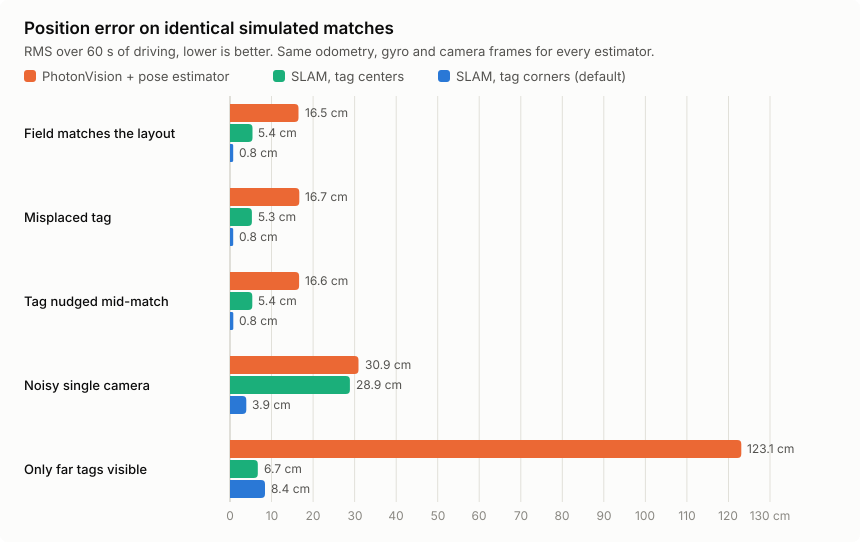

# Localization benchmark

<picture>
  <source media="(prefers-color-scheme: dark)" srcset="position-error-dark.svg">
  
</picture>

Generated by `./gradlew benchmark` on 2026-11-26. Every estimator is fed identical simulated matches: a robot lapping the 2026 field for 60 s, wheel odometry that over-reads by 3%, a gyro with an unknown 0.35 rad offset, and the template's two cameras (15° up, 80°×56° FOV, 30 fps, 35 ms latency) reporting raw tag corners from a 2D pipeline. Errors are measured every loop after a 3 s warm-up. Small tags are simulated honestly: corner noise grows as 1/√(edge length), tags under 20 px are increasingly missed (none under 10 px), and tags under 25 px are misread as another ID 0.2% of the time. Every number is the mean over 5 independent matches (seeds [4476, 101, 202, 303, 404]).

## Field matches the layout

Every tag exactly where the layout says. 1 px corner noise, two cameras.

| Estimator | Position RMS | p95 | Max | Heading RMS | Moved tag error |
|---|---|---|---|---|---|
| PhotonVision + pose estimator | 16.5 cm | 13.5 cm | 412.7 cm | 1.97° | – |
| SLAM, tag centers | 5.4 cm | 9.9 cm | 21.6 cm | 0.17° | – |
| SLAM, corners, fixed map | 0.7 cm | 1.2 cm | 4.6 cm | 0.12° | – |
| SLAM, corners (default) | 0.8 cm | 1.4 cm | 4.5 cm | 0.12° | – |
| SLAM, corners, autodiff (previous default) | 1.2 cm | 2.3 cm | 6.2 cm | 0.13° | – |
| SLAM, corners, autodiff, 40 keyframes | 0.8 cm | 1.6 cm | 4.5 cm | 0.12° | – |
| SLAM, corners, 25 keyframes | 0.8 cm | 1.5 cm | 5.0 cm | 0.12° | – |
| SLAM, corners, 60 keyframes | 0.8 cm | 1.4 cm | 4.2 cm | 0.12° | – |
| SLAM, corners, 100 keyframes | 0.8 cm | 1.4 cm | 4.2 cm | 0.12° | – |
| SLAM, corners, applied 3 loops later | 1.0 cm | 1.8 cm | 4.9 cm | 0.12° | – |
| SLAM, corners, far tags dropped | 0.8 cm | 1.4 cm | 4.1 cm | 0.12° | – |
| SLAM, corners, far corners kept | 0.7 cm | 1.2 cm | 4.3 cm | 0.12° | – |
| SLAM, tag centers, applied 3 loops later | 5.3 cm | 9.6 cm | 20.5 cm | 0.17° | – |
| SLAM, tag centers, 25 keyframes | 6.3 cm | 11.7 cm | 27.2 cm | 0.20° | – |
| SLAM, tag centers, far tags dropped | 5.5 cm | 9.9 cm | 20.1 cm | 0.18° | – |
| SLAM, tag centers, flat far σ | 5.4 cm | 9.9 cm | 21.6 cm | 0.17° | – |
| SLAM, tag centers, autodiff (previous default) | 5.5 cm | 10.3 cm | 28.2 cm | 0.17° | – |

PhotonVision's per-frame multi-tag PnP alone, before fusion: 53.6 cm RMS.

## Misplaced tag

The most-seen tag is 15 cm from its layout position all match.

| Estimator | Position RMS | p95 | Max | Heading RMS | Moved tag error |
|---|---|---|---|---|---|
| PhotonVision + pose estimator | 16.7 cm | 14.5 cm | 413.7 cm | 1.98° | 15.0 cm |
| SLAM, tag centers | 5.3 cm | 9.8 cm | 21.6 cm | 0.17° | 11.4 cm |
| SLAM, corners, fixed map | 1.7 cm | 2.6 cm | 14.8 cm | 0.12° | 15.0 cm |
| SLAM, corners (default) | 0.8 cm | 1.4 cm | 4.4 cm | 0.12° | 0.3 cm |
| SLAM, corners, autodiff (previous default) | 1.3 cm | 2.3 cm | 7.4 cm | 0.12° | 0.3 cm |
| SLAM, corners, autodiff, 40 keyframes | 0.8 cm | 1.6 cm | 4.5 cm | 0.12° | 0.3 cm |
| SLAM, corners, 25 keyframes | 0.8 cm | 1.5 cm | 4.9 cm | 0.12° | 0.3 cm |
| SLAM, corners, 60 keyframes | 0.8 cm | 1.4 cm | 4.1 cm | 0.12° | 0.3 cm |
| SLAM, corners, 100 keyframes | 0.8 cm | 1.4 cm | 4.2 cm | 0.12° | 0.5 cm |
| SLAM, corners, applied 3 loops later | 1.0 cm | 1.8 cm | 4.8 cm | 0.12° | 0.3 cm |
| SLAM, corners, far tags dropped | 0.8 cm | 1.4 cm | 4.1 cm | 0.12° | 0.3 cm |
| SLAM, corners, far corners kept | 0.7 cm | 1.2 cm | 4.3 cm | 0.12° | 0.2 cm |
| SLAM, tag centers, applied 3 loops later | 5.2 cm | 9.4 cm | 20.5 cm | 0.17° | 11.4 cm |
| SLAM, tag centers, 25 keyframes | 6.2 cm | 11.6 cm | 27.2 cm | 0.19° | 9.8 cm |
| SLAM, tag centers, far tags dropped | 5.4 cm | 9.8 cm | 20.1 cm | 0.17° | 11.4 cm |
| SLAM, tag centers, flat far σ | 5.2 cm | 9.8 cm | 21.6 cm | 0.17° | 11.4 cm |
| SLAM, tag centers, autodiff (previous default) | 5.5 cm | 10.2 cm | 25.1 cm | 0.17° | 9.8 cm |

PhotonVision's per-frame multi-tag PnP alone, before fusion: 53.7 cm RMS.

## Tag nudged mid-match

The most-seen tag is knocked 20 cm at t = 20 s.

| Estimator | Position RMS | p95 | Max | Heading RMS | Moved tag error |
|---|---|---|---|---|---|
| PhotonVision + pose estimator | 16.6 cm | 14.0 cm | 412.7 cm | 1.98° | 20.0 cm |
| SLAM, tag centers | 5.4 cm | 9.9 cm | 21.6 cm | 0.17° | 12.4 cm |
| SLAM, corners, fixed map | 1.1 cm | 1.6 cm | 15.7 cm | 0.12° | 20.0 cm |
| SLAM, corners (default) | 0.8 cm | 1.5 cm | 4.5 cm | 0.12° | 0.2 cm |
| SLAM, corners, autodiff (previous default) | 1.2 cm | 2.4 cm | 6.0 cm | 0.13° | 0.3 cm |
| SLAM, corners, autodiff, 40 keyframes | 0.9 cm | 1.6 cm | 4.5 cm | 0.12° | 0.2 cm |
| SLAM, corners, 25 keyframes | 0.8 cm | 1.6 cm | 5.0 cm | 0.12° | 0.3 cm |
| SLAM, corners, 60 keyframes | 0.8 cm | 1.4 cm | 4.2 cm | 0.12° | 0.2 cm |
| SLAM, corners, 100 keyframes | 0.8 cm | 1.5 cm | 4.2 cm | 0.12° | 0.3 cm |
| SLAM, corners, applied 3 loops later | 1.0 cm | 1.8 cm | 4.9 cm | 0.12° | 0.2 cm |
| SLAM, corners, far tags dropped | 0.8 cm | 1.4 cm | 4.1 cm | 0.12° | 0.2 cm |
| SLAM, corners, far corners kept | 0.7 cm | 1.3 cm | 4.3 cm | 0.12° | 0.2 cm |
| SLAM, tag centers, applied 3 loops later | 5.2 cm | 9.4 cm | 20.5 cm | 0.17° | 12.5 cm |
| SLAM, tag centers, 25 keyframes | 6.2 cm | 11.6 cm | 27.2 cm | 0.19° | 11.8 cm |
| SLAM, tag centers, far tags dropped | 5.5 cm | 9.9 cm | 20.1 cm | 0.17° | 12.7 cm |
| SLAM, tag centers, flat far σ | 5.3 cm | 9.9 cm | 21.6 cm | 0.17° | 12.4 cm |
| SLAM, tag centers, autodiff (previous default) | 5.5 cm | 10.2 cm | 27.6 cm | 0.17° | 11.6 cm |

PhotonVision's per-frame multi-tag PnP alone, before fusion: 53.5 cm RMS.

## Noisy single camera

One camera only, 3 px corner noise (motion blur, a cheap lens).

| Estimator | Position RMS | p95 | Max | Heading RMS | Moved tag error |
|---|---|---|---|---|---|
| PhotonVision + pose estimator | 30.9 cm | 46.4 cm | 413.5 cm | 2.84° | – |
| SLAM, tag centers | 28.9 cm | 54.6 cm | 125.3 cm | 0.84° | – |
| SLAM, corners, fixed map | 3.5 cm | 6.6 cm | 20.5 cm | 0.38° | – |
| SLAM, corners (default) | 3.9 cm | 7.7 cm | 14.0 cm | 0.31° | – |
| SLAM, corners, autodiff (previous default) | 7.0 cm | 11.1 cm | 58.7 cm | 0.72° | – |
| SLAM, corners, autodiff, 40 keyframes | 4.1 cm | 7.9 cm | 17.6 cm | 0.33° | – |
| SLAM, corners, 25 keyframes | 4.4 cm | 9.4 cm | 19.4 cm | 0.41° | – |
| SLAM, corners, 60 keyframes | 3.8 cm | 7.3 cm | 12.6 cm | 0.22° | – |
| SLAM, corners, 100 keyframes | 3.8 cm | 7.1 cm | 13.2 cm | 0.17° | – |
| SLAM, corners, applied 3 loops later | 3.8 cm | 7.6 cm | 12.6 cm | 0.28° | – |
| SLAM, corners, far tags dropped | 3.9 cm | 7.4 cm | 13.3 cm | 0.31° | – |
| SLAM, corners, far corners kept | 3.2 cm | 6.4 cm | 13.9 cm | 0.28° | – |
| SLAM, tag centers, applied 3 loops later | 26.4 cm | 47.2 cm | 110.3 cm | 0.71° | – |
| SLAM, tag centers, 25 keyframes | 24.6 cm | 47.3 cm | 111.4 cm | 0.80° | – |
| SLAM, tag centers, far tags dropped | 29.4 cm | 61.8 cm | 122.1 cm | 0.78° | – |
| SLAM, tag centers, flat far σ | 28.8 cm | 53.7 cm | 125.8 cm | 0.84° | – |
| SLAM, tag centers, autodiff (previous default) | 22.1 cm | 44.1 cm | 95.9 cm | 0.61° | – |

PhotonVision's per-frame multi-tag PnP alone, before fusion: 91.8 cm RMS.

## Only far tags visible

Every tag within 8 m of the robot is hidden (blocked by robots and game pieces), so only tags across the field can be seen. 1 px corner noise, two cameras.

| Estimator | Position RMS | p95 | Max | Heading RMS | Moved tag error |
|---|---|---|---|---|---|
| PhotonVision + pose estimator | 123.1 cm | 298.8 cm | 578.6 cm | 8.10° | – |
| SLAM, tag centers | 6.7 cm | 14.6 cm | 22.5 cm | 0.18° | – |
| SLAM, corners, fixed map | 6.1 cm | 13.7 cm | 22.6 cm | 0.20° | – |
| SLAM, corners (default) | 8.4 cm | 18.5 cm | 29.4 cm | 0.22° | – |
| SLAM, corners, autodiff (previous default) | 9.4 cm | 19.6 cm | 34.1 cm | 0.25° | – |
| SLAM, corners, autodiff, 40 keyframes | 8.4 cm | 18.6 cm | 29.4 cm | 0.22° | – |
| SLAM, corners, 25 keyframes | 9.2 cm | 20.2 cm | 28.6 cm | 0.25° | – |
| SLAM, corners, 60 keyframes | 7.7 cm | 15.8 cm | 28.8 cm | 0.20° | – |
| SLAM, corners, 100 keyframes | 6.6 cm | 12.8 cm | 25.0 cm | 0.17° | – |
| SLAM, corners, applied 3 loops later | 8.4 cm | 18.0 cm | 27.3 cm | 0.21° | – |
| SLAM, corners, far tags dropped | 12.3 cm | 20.4 cm | 25.6 cm | 0.17° | – |
| SLAM, corners, far corners kept | 9.1 cm | 19.8 cm | 30.2 cm | 0.43° | – |
| SLAM, tag centers, applied 3 loops later | 6.5 cm | 13.7 cm | 20.6 cm | 0.18° | – |
| SLAM, tag centers, 25 keyframes | 7.5 cm | 15.0 cm | 23.8 cm | 0.22° | – |
| SLAM, tag centers, far tags dropped | 11.4 cm | 19.8 cm | 23.6 cm | 0.17° | – |
| SLAM, tag centers, flat far σ | 6.0 cm | 13.1 cm | 21.2 cm | 0.18° | – |
| SLAM, tag centers, autodiff (previous default) | 7.4 cm | 15.2 cm | 20.9 cm | 0.22° | – |

PhotonVision's per-frame multi-tag PnP alone, before fusion: 299.0 cm RMS.

## Solve time

Measured serially, with nothing else running, on "Field matches the layout" (seed 4476). Build and solve, wall-clock, per solve.

| Estimator | Mean | p95 |
|---|---|---|
| SLAM, tag centers | 0.66 ms | 1.41 ms |
| SLAM, corners, fixed map | 0.28 ms | 0.34 ms |
| SLAM, corners (default) | 0.52 ms | 0.70 ms |
| SLAM, corners, autodiff (previous default) | 13.91 ms | 21.35 ms |
| SLAM, corners, autodiff, 40 keyframes | 22.55 ms | 33.81 ms |
| SLAM, corners, 25 keyframes | 0.23 ms | 0.33 ms |
| SLAM, corners, 60 keyframes | 1.26 ms | 1.60 ms |
| SLAM, corners, 100 keyframes | 4.66 ms | 5.41 ms |
| SLAM, corners, applied 3 loops later | 0.50 ms | 0.69 ms |
| SLAM, corners, far tags dropped | 0.44 ms | 0.61 ms |
| SLAM, corners, far corners kept | 0.54 ms | 0.74 ms |
| SLAM, tag centers, applied 3 loops later | 0.44 ms | 0.59 ms |
| SLAM, tag centers, 25 keyframes | 0.18 ms | 0.26 ms |
| SLAM, tag centers, far tags dropped | 0.38 ms | 0.51 ms |
| SLAM, tag centers, flat far σ | 0.44 ms | 0.59 ms |
| SLAM, tag centers, autodiff (previous default) | 3.98 ms | 6.05 ms |

### Estimators

- **PhotonVision + pose estimator:** PhotonVision multi-tag PnP per frame, WPILib pose estimator, AdvantageKit std devs.
- **SLAM, tag centers:** Bearing and range per tag (no corners); otherwise the defaults.
- **SLAM, corners, fixed map:** Default, but the tag map is held at the layout.
- **SLAM, corners (default):** The template's defaults: Gauss-Newton, solved inside the loop, 40 keyframes.
- **SLAM, corners, autodiff (previous default):** The previous defaults: autodiff solver on a second core, applied 3 loops later, 25 keyframes.
- **SLAM, corners, autodiff, 40 keyframes:** Default, but solved by the autodiff solver.
- **SLAM, corners, 25 keyframes:** Default, with the smaller window.
- **SLAM, corners, 60 keyframes:** Default, with a larger window.
- **SLAM, corners, 100 keyframes:** Default, with a much larger window.
- **SLAM, corners, applied 3 loops later:** Default, but solved on a second core and applied 3 loops later.
- **SLAM, corners, far tags dropped:** Default, but ignoring every tag beyond 7 m.
- **SLAM, corners, far corners kept:** Default, but tags beyond 7 m still use their corners.
- **SLAM, tag centers, applied 3 loops later:** Tag centers, solved on a second core and applied 3 loops later.
- **SLAM, tag centers, 25 keyframes:** Tag centers, with the smaller window.
- **SLAM, tag centers, far tags dropped:** Tag centers, ignoring every tag beyond 7 m.
- **SLAM, tag centers, flat far σ:** Tag centers, far bearings trusted as much as near ones.
- **SLAM, tag centers, autodiff (previous default):** Tag centers with the previous defaults.

"Moved tag error" is how far the estimator believes the moved tag is from where it really is at the end of the match. The PhotonVision pipeline can't learn tags, so its value is the layout's own error.

### Why the PhotonVision pipeline does worse

Its per-frame multi-tag PnP is excellent when three or more tags are in view (a few centimeters). With one tag, or two tags on the same face of a field element, all the corners lie in one plane and PnP can flip to the mirror-image solution with almost no reprojection error; those flips are the long tail (p95, max). Fusion with distance-scaled standard deviations then trades that noise against odometry drift. The SLAM never solves a pose from a single frame: every corner constrains a trajectory that odometry and the gyro also constrain, so a planar ambiguity has nowhere to go.
